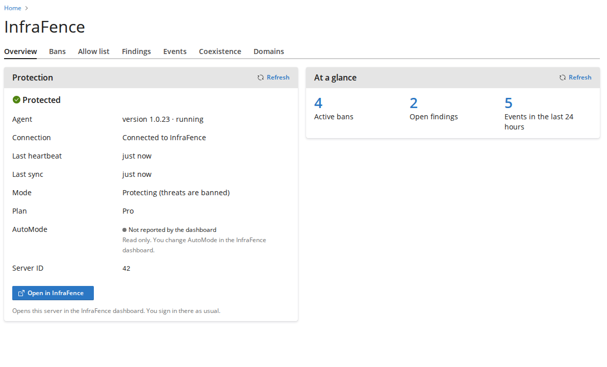

# InfraFence for Plesk

A Plesk Obsidian extension (18.0.60 or later, Linux) that shows the InfraFence agent running on the
server, inside Plesk, for the administrator:

| Screen | What it shows | Actions |
|---|---|---|
| Overview | Protection status, agent version and heartbeat, connection, plan, AutoMode (read only), counts | Open in InfraFence |
| Bans | Active bans: address, reason, who banned it, when, expiry | Unban, Unban and allow |
| Allow list | Entries added here and the organization's entries from the dashboard, note, who added them | Add address, Remove (entries added here) |
| Findings | Malware and file integrity findings since the agent started | Manage in InfraFence (link) |
| Events | Recent security events, last 24 hours / 7 / 30 days | |
| Coexistence | The other security tools the agent found (CSF/lfd, Imunify360/ImunifyAV, cPHulk, fail2ban, CrowdSec, Plesk Firewall, BitNinja, Monarx, firewalld, ufw, ModSecurity and its rule sets) and what InfraFence does about each | |
| Domains | Sites as the agent reads them from Plesk, and whether the scheduled scan covers them | Scan now (sites the agent can scan) |

When the agent is missing, the extension shows one screen that sends the administrator to the dashboard
(Servers > Add server, https://infrafence.com/add-server) to get the install command.
It also adds a button on the Home page and in the left navigation, a status block on the Home page
(Security section of Customize), and Plesk Action Log events for every change.

Text is in en-US, it-IT, es-ES, fr-FR, de-DE, pt-PT and pt-BR.



## How it works

```
browser ──(Plesk session, admin only, CSRF token)──▶ plib/controllers/ApiController.php   runs as psaadm
                                                          │ pm_ApiCli::callSbin('infrafence-panel', [argv…])
                                                          ▼
                                   /usr/local/psa/admin/sbin/modules/infrafence/infrafence-panel   root
                                                          │ validates, clears the environment, exec (no shell)
                                                          ▼
                                   infrafence-agent panel <command> [args] --json      (docs/panel-json.md)
```

- **Administrator only.** Every controller has `$_accessLevel = 'admin'` and checks the session again;
  hooks only use administrator places. Customers and resellers are turned away by Plesk.
- **Changes are POST only**, sent with Plesk's forgery protection token (Plesk rejects a POST without
  a valid token before the extension runs) and confirmed by the user in a dialog.
- **Preflight before every change.** The agent must report `agent_running`, and the target must exist in
  the agent's current state: the address must be banned to unban it, an entry must be in the allow list and
  added from the panel to remove it, the document root must be a site the agent marks `scannable`.
- **Input is validated three times**: in the browser, in PHP (one IPv4 or IPv6 address, no ranges, no
  unspecified, broadcast or multicast address; notes up to 200 bytes), and in the root wrapper. The agent
  checks everything again.
- **The wrapper** (`src/sbin/infrafence-panel`) accepts only the contract commands and options, checks each
  value against the agent's own rules, requires `scan` paths to resolve (`readlink -e`) inside the Plesk vhosts
  directory (`HTTPD_VHOSTS_D`), runs the agent only if the binary and its directory are owned by root and not
  writable by others, clears the environment, and applies a 25 second timeout. Its refusals use the agent's
  error shape and codes (`bad_request`, `invalid_ip`, `invalid_actor`, `invalid_path`, `not_a_document_root`,
  `unknown_command`), plus `agent_not_installed` and `agent_untrusted` of its own; exit status 1.
- **It changes nothing on the host by itself.** Installing the extension adds files under Plesk's own
  directories only. It never touches iptables, nftables, ModSecurity, fail2ban or other tools; all changes
  go through the agent, which reports them to the dashboard as `panel_*` events with the Plesk login as
  the actor (`--actor admin`). Removing the extension leaves nothing behind.
- **No credentials.** The extension stores no token. "Open in InfraFence" is a plain https link to the
  server's page on the dashboard; the user signs in there normally.

The UI is React on the Plesk UI library that Plesk itself loads (the `plesk-ui-library` AMD module), so it
follows the panel version and its themes (the default Contrast theme and the dark theme) without any
styling of its own beyond spacing. The bundle is about 45 KB.

## Agent replies

The replies are documented in [docs/panel-json.md](../docs/panel-json.md), the agent's own reference (the
same file in both plugins), and `dev/fixtures/` holds the agent's real outputs (`testdata/panel/*.json` of the
agent repository, unchanged). The extension follows them field by field:

- `status`: protection state from `agent_running`, `suspended`, `connected` and `monitor_mode`; `version`,
  `last_heartbeat`, `last_sync`, `plan`, `agent_id`, `dashboard_url` (https only). `automode` is shown as "not
  reported" while the dashboard sends `null`. Without a running agent the `null` fields show as "–".
- `bans`: `reason` is free text (shown as is, escaped), `created` and `expires` may be `null`, `total` beyond the
  500 listed is mentioned; `monitor_mode` is announced. `unban` replies: `scope`, `source` and `lifted_until`
  are shown ("lifted on this server only, until …"), with `reported`, `threat_feed` and `firewall_pending`.
- `allow`: one address only; `already`, `banned`, `own_address` and `loopback_address` each get their own
  message. `allowlist`: `source` `panel` entries can be removed, `dashboard` entries (and ranges) cannot.
- `findings`: `name`, `status` `detected`/`quarantined`, `detected` and `last_seen`; severities of both kinds.
- `events`: known `type` codes are translated, unknown ones shown as sent; `source` is "Reported by".
- `coexistence`: only the tools found; "What InfraFence does" is translated by `action_id`, and the agent's
  English `action` is shown for English or for an id this version does not know.
- `sites`: `scan_covered` ("Scheduled scan"), `scannable` (Scan now only when true), `malware_scan_enabled`
  (a notice when `false`), `kind` shown when the panel has several kinds (cPanel).
- Errors: every code in the reference has a translated message; `message` (English) is written to the Plesk
  log only.

## Layout

```
plesk/
  build.sh                 builds dist/infrafence-plesk-<version>-<release>.zip in Docker
  extension.config.js      build settings for plesk-ext-sdk (entry point, no generated index.php)
  package.json, yarn.lock  build dependencies (the zip contains no node modules)
  src/                     the extension: everything here except frontend/ goes into the zip
    meta.xml
    _meta/icons/           32x32, 64x64, 128x128
    _meta/screenshots/
    htdocs/                index.php, css/, images/, dist/main.js (built)
    plib/controllers/      IndexController (the page), ApiController (JSON endpoints)
    plib/hooks/            Navigation, CustomButtons, Home (status block), ActionLog
    plib/library/          Agent (calls the wrapper), Validate, Config, Messages, HomeBlock
    plib/resources/locales/
    plib/views/
    sbin/infrafence-panel  root wrapper
    frontend/              React sources (not shipped)
  dev/
    mock-agent             stand-in for infrafence-agent built on the reference outputs
    fixtures/              the agent's reference outputs (copied from the agent repository, unchanged)
    check-mock.py          the mock answers like the reference: keys, exit status, bytes (run by build.sh)
    install-mock.sh        puts the mock on a test container or VM
    test-wrapper.sh        checks that the wrapper refuses everything outside the contract
    check-locales.php      every locale has every key (run by build.sh)
    icon.svg               source of the icons
```

## Build

```sh
./build.sh
```

Needs only Docker: PHP lint and the locale check run in `php:8.3-cli`; the mock check and the UI build
(`plesk-ext-sdk`) run in `node:20`. Output: `dist/infrafence-plesk-1.0.0-1.zip`.

## Install

```sh
plesk bin extension -i infrafence-plesk-1.0.0-1.zip     # install or upgrade
plesk bin extension -u infrafence                       # remove
```

Optional setting in `/usr/local/psa/admin/conf/panel.ini` (https links only):

```ini
[ext-infrafence]
; where the "agent not installed" screen sends the administrator to add this server
addServerUrl = "https://infrafence.com/add-server"
```

"Open in InfraFence" always uses the `dashboard_url` the agent reports.

Testing: see [TESTING.md](TESTING.md).
