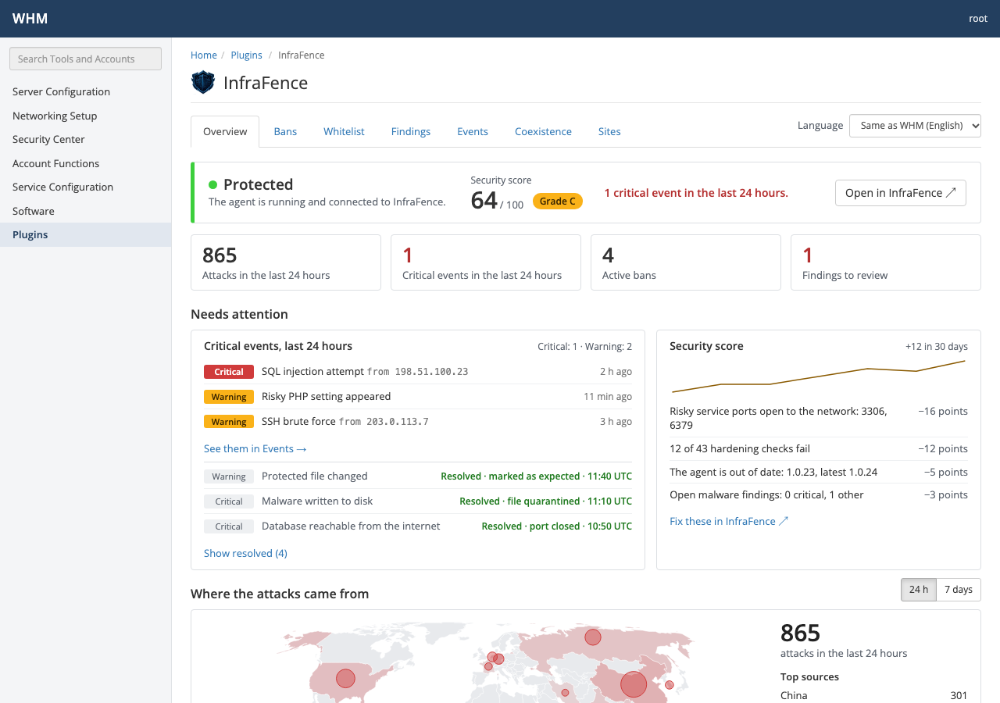
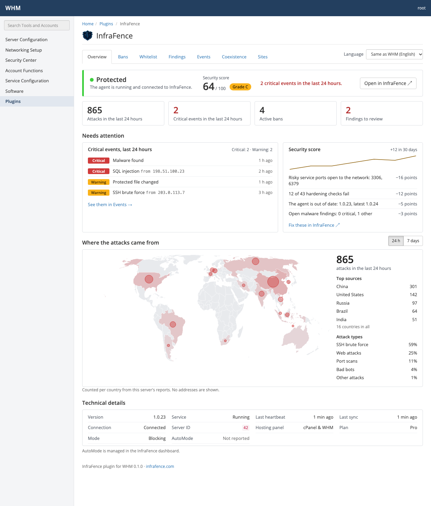
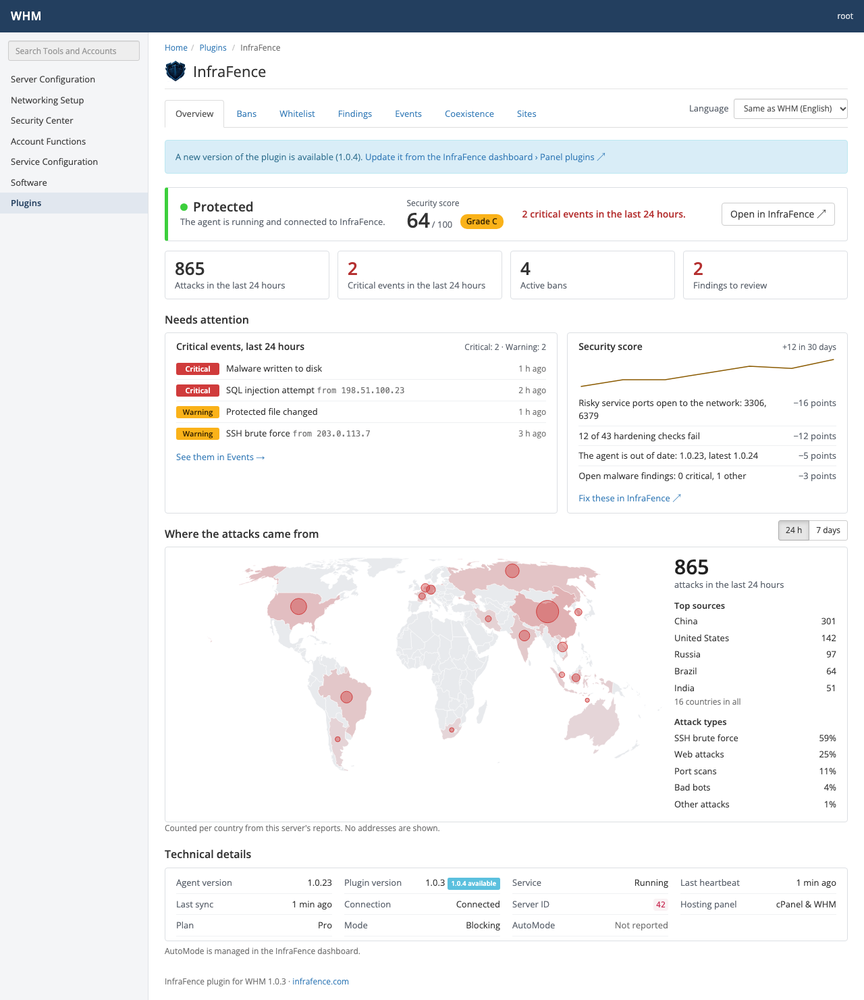

# InfraFence for cPanel & WHM

A WHM plugin for root: **WHM » Plugins » InfraFence**. It shows what the InfraFence agent on the server
is doing and lets you act on it, inside WHM's own interface. It is included in the **Basic, Pro and AutoMode**
plans (not Starter): install it from your InfraFence dashboard (Panel plugins › cPanel & WHM). Install guide on the
site: [WHM plugin](https://infrafence.com/docs/whm-plugin).

| Screen | What it shows |
|---|---|
| Overview | At a glance: protection status, security score and grade, and whether anything needs attention; the key figures (attacks, critical events, bans, findings); the last 24 hours' critical events still open (and the latest ones resolved) and what takes points off the score, with a link to fix it in InfraFence; a world map of where this server's attacks came from (24 hours or 7 days); then the technical details (agent version, plugin version, heartbeat, plan, AutoMode) |
| Bans | Active bans; unban, or add the address to the whitelist |
| Whitelist | Addresses that are never banned, from this server and from the dashboard; add and remove |
| Findings | Malware and file integrity findings, and whether each is resolved |
| Events | Recent security events with their state (open, resolved), filtered by state and by severity (all, warning and above, critical) |
| Coexistence | Other security tools found (CSF, lfd, Imunify360, cPHulk, ModSecurity and its rule sets…) and how InfraFence works with each |
| Sites | Accounts, domains and document roots with malware scan coverage; start a scan |

The security score and the attack map need InfraFence agent 1.0.33 or later (`panel score`, `panel map`).
With an older agent the rest of the plugin works and the Overview asks to update the agent.

**Open or resolved.** From agent 1.0.34, `panel events` and `panel findings` say whether each problem
(a database port open to the internet, a changed system file, a risky PHP setting, malware...) is still open
or resolved, and how: resolved in the dashboard (port closed, fix applied, marked as expected...) or fixed by
the agent itself. Resolved problems no longer count as critical events or findings to review, and leave "Needs
attention"; the Overview lists the three most recently resolved in the last 24 hours ("Resolved · port closed
· 10:50 UTC") and links to the rest ("Show resolved (N)"). The Events page has a State column and an Open /
Resolved / All filter. With an older agent every event is open, as before.

When the agent is not installed, the plugin says how to add the server in the InfraFence dashboard
(Servers > Add server) and links to https://infrafence.com/add-server.

**Plans.** The plugin works when the organization's plan is Basic, Pro or AutoMode and protection is not
switched off for non-payment. Otherwise every page says why, with all figures at 0, empty lists and map, no
score, and the actions off:

- Starter (or any plan without the plugin): "The InfraFence plugin is included in the Basic, Pro and AutoMode
  plans", with a link to upgrade in the dashboard.
- Subscription not active (protection `disabled`, after the 72-hour stop and 24 hours of refusals): "Your
  InfraFence subscription is not active: the plugin shows no data until it is".
- Plan not known yet (the agent has not synced, or the dashboard does not send it): "Waiting for the
  InfraFence dashboard".

The plugin decides from `panel status` (`plan`, `protection`; agent 1.0.33) and, from agent 1.0.34, the
agent's own `entitlement`. Then it calls no other agent command, and refuses every action before it reaches
the agent, a hand-made POST included (HTTP 403). An agent that refuses a command with `plan_required`,
`unpaid` or `unknown` (1.0.34 and later) gets the same pages.

## How it works

The plugin is a thin interface. Every screen runs one command as root and reads JSON:

    infrafence-agent panel <command> [args] --json

(see [../docs/panel-contract.md](../docs/panel-contract.md); every field is described in
[../docs/panel-json.md](../docs/panel-json.md)). It holds no InfraFence credentials and never
changes the firewall, ModSecurity or any other tool by itself.

- **Access.** Registered with `acls=all`, and the CGI checks `Whostmgr::ACLS::hasroot()` again.
- **Changes.** Unban, allow, remove and scan always show a confirmation page first. The change runs only on
  a POST that carries the session's WHM security token. A request from another site is refused.
- **Input.** IP addresses are validated (IPv4 without leading zeros, IPv6 normalized). Whitelist notes
  are limited to 200 bytes, with no control characters. Scans only accept document roots the agent
  itself listed as `scannable` (inside the account's home and owned by it).
- **Scope.** The agent's replies cover the whole server (all accounts), so the plugin is for root only.
  An unban from the panel lifts the ban on this server only, for at most 30 days; the plugin says so before
  and after.
- **Running the agent.** The command is started from an argv list, never through a shell. It runs with a
  clean environment, no stdin, a 20-second limit (25 seconds in total for the Overview's calls) and capped
  output. The binary is resolved with `realpath`; it and every directory above it must be owned by root and
  not writable by group or others, and the resolved file is what runs.
- **Output.** Everything is escaped in the templates. Messages after an action come from a fixed list; the
  values in them are re-derived (canonical address, re-formatted date), never echoed from the URL. The
  "Open in InfraFence" link is shown only for a strict `https://host/path` URL and sends no referrer, so
  the WHM session token never leaves the server.
- **Files.** Everything installed is owned by root and writable only by root, whatever the build's umask
  (`make umask-test`).
- **Language.** The text follows the WHM user's locale: English, Italian, Spanish, French, German or
  Portuguese (`plugin/locale/*.json`). Each WHM user can pick another one with the selector at the top of
  the plugin (a POST with the WHM security token); the choice is stored per WHM user in
  `/var/cpanel/infrafence-whm/prefs/<user>.json` (directory 0700, file 0600, root only). "Same as WHM" removes it.
- **Map.** The attack map is drawn on the server as inline SVG, from a world outline shipped with the plugin
  (`plugin/map/`, Natural Earth, public domain; attribution in `plugin/map/NOTICE`). The page loads nothing
  from other sites and needs no JavaScript. Country codes and counts from the agent are checked before they
  are drawn.
- **Score and map from the dashboard.** `panel map` and `panel score` (agent 1.0.33 or later) are answered by
  the agent from the InfraFence dashboard, cached by the agent (at most one request every 5 minutes for the
  map and 15 minutes for the score). With an older agent that does not know them, or before the
  server has reached the dashboard, the Overview says so calmly; when the agent can only give its last copy,
  it shows when that was.

## Install

Install it from your InfraFence dashboard: **Panel plugins › cPanel & WHM** gives a signed install command to run as
root on the server. You need an InfraFence account (https://infrafence.com). The
installer checks the server first. If a check fails, nothing is changed. Services are never restarted.

**From source** (developers): `make packages` builds `dist/` (tarball, RPM, `.deb`) in Docker. Then, as root:

    tar xzf dist/infrafence-whm-VERSION.tar.gz
    cd infrafence-whm-VERSION
    ./install.sh --check    # optional: only run the checks
    ./install.sh

or `dnf install ./infrafence-whm-VERSION-1.noarch.rpm` (AlmaLinux 8/9/10, CloudLinux, Rocky), or
`apt install ./infrafence-whm_VERSION_all.deb` (Ubuntu 24.04).

To remove: `/usr/local/share/infrafence-whm/uninstall.sh` (tarball install), `dnf remove infrafence-whm`
or `apt remove infrafence-whm`. Uninstalling removes only the plugin, never the agent.

### Updating the plugin

The plugin is updated from the dashboard, separately from the agent: updating the agent never updates the
plugin. Open **Panel plugins › cPanel & WHM** again, copy a fresh install command (its link works for one hour)
and run it as root; it replaces the plugin in place and keeps each WHM user's language.

Technical details on the Overview show both versions, **Agent version** and **Plugin version**. With agent
1.0.35 or later, `panel status` also carries `plugin_latest`, the latest release the dashboard knows of. When it
is newer than this plugin, every page shows a calm notice, "A new version of the plugin is available (1.0.4).
Update it from the InfraFence dashboard › Panel plugins", linking to https://infrafence.com/panels, and the
Plugin version row says "1.0.4 available". Nothing is shown while the organization is not entitled (Starter,
unpaid, plan unknown), or with an older agent.

### Files

| Path | |
|---|---|
| `/usr/local/cpanel/whostmgr/docroot/cgi/infrafence/index.cgi` | the CGI |
| `/usr/local/cpanel/whostmgr/docroot/templates/infrafence/` | Template Toolkit templates, wrapped in `master_templates/master.tmpl` |
| `/usr/local/cpanel/whostmgr/docroot/addon_plugins/infrafence.png` | icon |
| `/usr/local/share/infrafence-whm/` | Perl modules, translations, world map data, AppConfig file, install and uninstall scripts |
| `/var/cpanel/apps/infrafence.conf` | written by `register_appconfig` |
| `/var/cpanel/infrafence-whm/prefs/` | each WHM user's language choice, written by the plugin; removed by `uninstall.sh` |

## Development

    make test           # unit, controller and rendering tests (Docker, AlmaLinux 9)
    make install-test   # install.sh/uninstall.sh and the CGI on a fake cPanel tree, AlmaLinux 8, 9, 10
    make packages       # dist/: tar.gz, .rpm, .deb, built in Docker
    make package-test   # installs and removes the .rpm and the .deb in containers
    make screenshots    # renders every screen with the mock agent and captures it

`dev/mock-agent` answers the panel commands like the real agent, from `dev/fixtures/` (copies of the agent's
own outputs). It also has a stopped agent, monitor mode, empty lists, hostile content for escaping tests,
the plans (`starter`, `unpaid`, `unknown`, `paid`), an agent that gates by plan (`MOCK_AGENT_GATE=new`) or
refuses with `plan_required`, `unpaid` or `unknown` (`MOCK_AGENT_REFUSE`), an agent that reports the latest
plugin release (`MOCK_AGENT_PLUGIN_LATEST=<version>`), and faults (timeouts, invalid output).
[TESTING.md](TESTING.md) covers the checks on a real cPanel server.

### Releasing

A release is a tag `whm-vX.Y.Z` that matches `VERSION`. The packages customers install are built from that tag,
tested (`make test`, `make package-test`) and served by the InfraFence dashboard.

Before a release: bump `VERSION`, `$VERSION` in `plugin/lib/InfraFence/WHM/App.pm` (checked by
`t/00-compile.t`) and the `%changelog` in `packaging/rpm/infrafence-whm.spec`.

## Layout

    install.sh, uninstall.sh   installer (also used by the packages)
    plugin/cgi/                index.cgi
    plugin/lib/                InfraFence::WHM::{App,Agent,CGI,I18n,Map,Prefs,Score,Validate,Util}
    plugin/templates/          WHM templates
    plugin/locale/             en, it, es, fr, de, pt
    plugin/map/                world outline and country names for the attack map (generated by dev/world-map/)
    plugin/appconfig/          AppConfig file
    dev/                       mock agent, fixtures (agent outputs), scenarios, stub master template, renderer
    t/                         Test::More tests
    test/install/              install test on a fake cPanel tree
    packaging/                 RPM spec, Debian control files, build script
